# 이미지 처리 결과 기록

[프로젝트 README](../README.md)

## 판정과 실험 조건

- **No document가 나오면 해당 시도는 실패.** 결과가 있어도 문서 경계를 잘못 잡으면 실패다.
- 기본 `blur=5`부터 시작해 홀수 `1~31` 전체를 확인했다. 20장 × 16개 값 = **320회**. Canny는 `low=50, high=100`으로 고정했다.
- 기본값 결과가 정상이면 채택한다. 실패 시 다른 블러 결과를 검토하고, 정상 결과가 없으면 최종 실패로 기록한다.
- 통과 기준은 문서 외곽이 맞고 Warp가 생성되는 것이다. 글자 하나하나의 보존·실제 종횡비까지 보장하지는 않는다. `tilted_05`는 외곽 후보가 있지만 보정 비율이 의심되어, 실제 문서 비율과 대조하기 전까지 보류한다. 보류는 통과·실패에 합치지 않고 별도로 집계한다.
- 아래 이미지는 현재 코드의 처리 배열을 새로 만든 프리뷰다. 실제 GUI 캡처는 아니며, 클릭하면 크게 볼 수 있다. 앱 코드·원본 사진은 변경하지 않았다.
- 이전 closing 실험은 제외했다. 이 문서의 실패는 **이번 블러/Canny 범위에서의 실패**이며 다른 방법까지 불가능하다는 뜻은 아니다.

## 전체 결과

| 파일명 그룹 | 통과 | 실패 | 보류 | 통과율 |
| --- | ---: | ---: | ---: | ---: |
| easy | 5 | 0 | 0 | 100% |
| shadow | 5 | 0 | 0 | 100% |
| tilted | 4 | 0 | 1 | 80% |
| complex | 1 | 4 | 0 | 20% |
| 전체 | **15** | **4** | **1** | **75%** |

원본 20장 중 통과 **75%**, 실패 **20%**, 보류 **5%**. 출처·실제 촬영 조건은 미확인이며 파일명 기준으로 분류했다.

통과율은 **통과 수 ÷ 해당 그룹의 전체 이미지 수**이며, 보류도 분모에 포함한다. `tilted`의 보류율은 20%다. 기본값에서 사각형 후보가 나온 16장(80%)과, 결과 검토 후 통과한 15장(75%)은 구분한다.

**히스토그램:** 가로축은 밝기 0(검정)~255(흰색), 세로축은 픽셀 비율이다. 평균 밝기가 낮은 shadow는 모두 검출됐지만 더 밝은 complex에서는 실패가 많았다. 밝기 분포만으로 경계 단절이나 가림을 설명할 수는 없다.

## 이미지별 결과

미검출 블러 목록의 값은 **모두 실패**다. 나머지 값은 자동 후보가 생성된 값일 뿐, 개별 검토 없이 정상으로 확정하지 않는다. 통과 이미지의 채택값은 모두 `blur=5`다.

### easy_01 — 통과

- **입력:** 단순 배경의 문서.
- **결과·결론:** 외곽과 본문·표가 유지됐다.
- **No document 실패 블러:** 27, 29, 31.

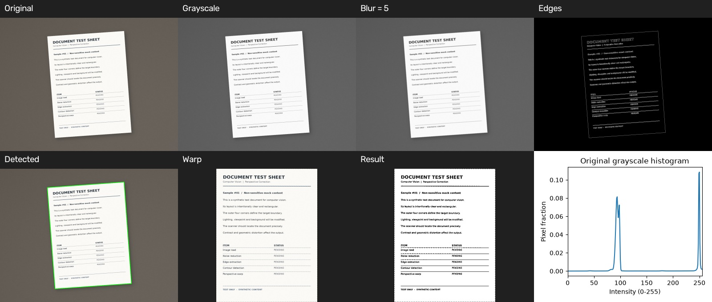

### easy_02 — 통과

- **입력:** 약하게 기울어진 문서.
- **결과·결론:** 외곽 보정은 양호하나 이진화에서 가는 표 선 일부가 끊긴다.
- **No document 실패 블러:** 23, 25, 27, 29, 31.

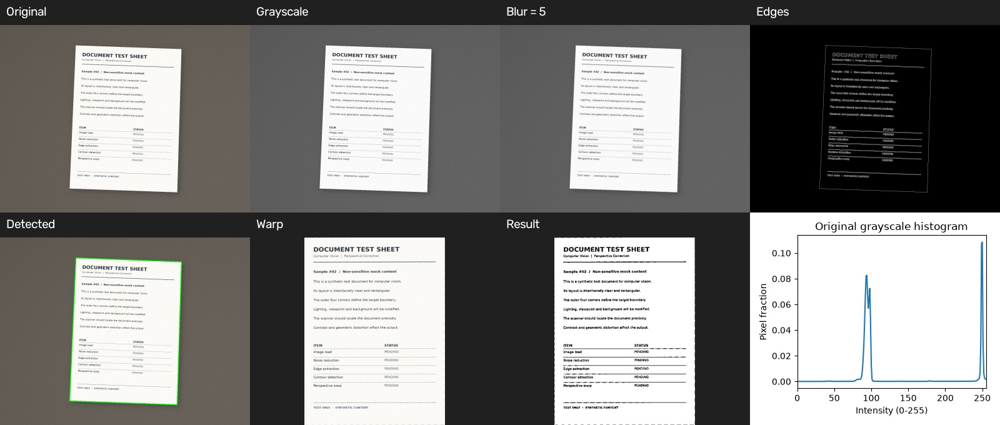

### easy_03 — 통과

- **입력:** 길고 좁은 영수증.
- **결과·결론:** 세로로 보정됐으며 작은 글씨는 원본 크기에서 확인해야 한다.
- **No document 실패 블러:** 29, 31.

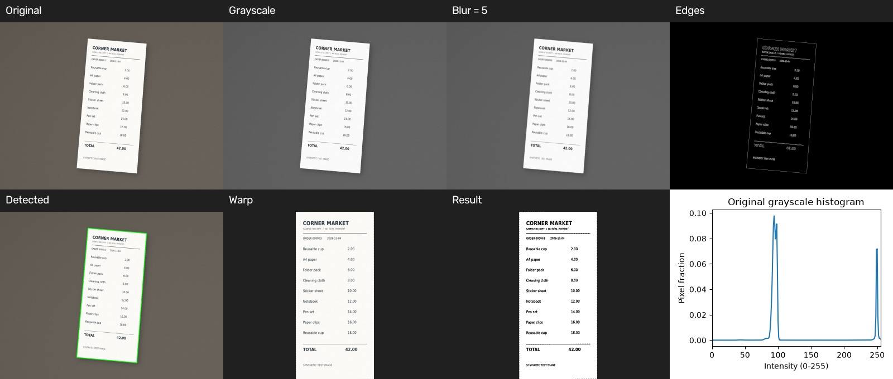

### easy_04 — 통과

- **입력:** 로고가 있는 명함.
- **결과·결론:** 외곽은 맞지만 흑백 결과에서 로고의 채움이 사라진다.
- **No document 실패 블러:** 23, 25, 27, 31.

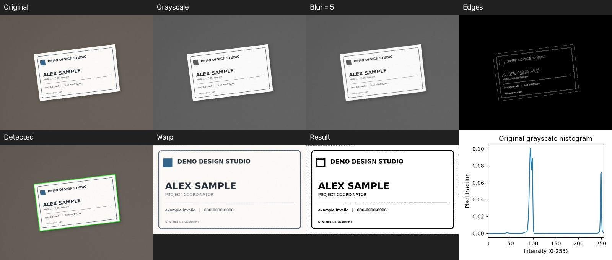

### easy_05 — 통과

- **입력:** 거의 정면인 문서.
- **결과·결론:** 문서 전체와 표 구조가 유지됐다.
- **No document 실패 블러:** 21, 23, 25, 27, 29, 31.

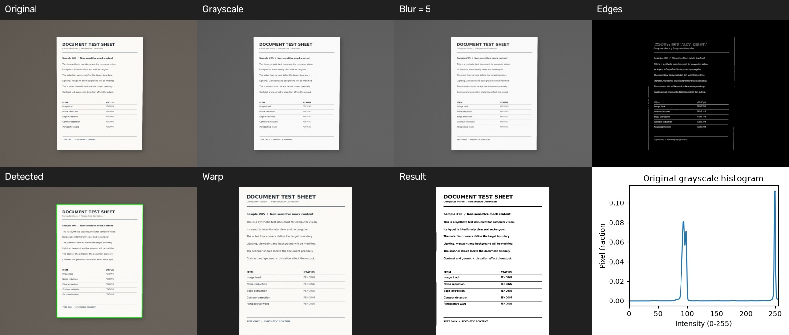

### shadow_01 — 통과

- **입력:** 문서 대부분이 어둡다.
- **결과·결론:** 어두운 상태에서도 외곽을 찾았고 이진화로 배경이 밝아졌다.
- **No document 실패 블러:** 11, 13, 15, 17, 19, 21, 23, 25, 27, 29, 31.

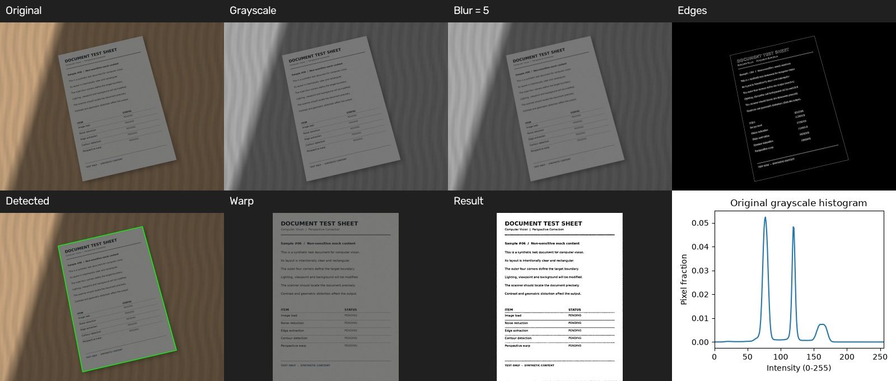

### shadow_02 — 통과

- **입력:** 영수증을 대각선 그림자가 가로지른다.
- **결과·결론:** 문서가 보정됐고 Result에서 큰 그림자 영역이 줄었다.
- **No document 실패 블러:** 9, 11, 13, 15, 17, 19, 21, 23, 25, 27, 29, 31.

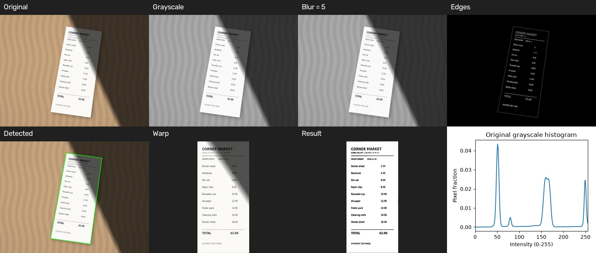

### shadow_03 — 통과

- **입력:** 왼쪽 일부만 밝은 문서.
- **결과·결론:** 배경은 밝아졌지만 가는 표 선이 일부 끊긴다.
- **No document 실패 블러:** 13, 15, 17, 19, 21, 23, 25, 27, 29, 31.

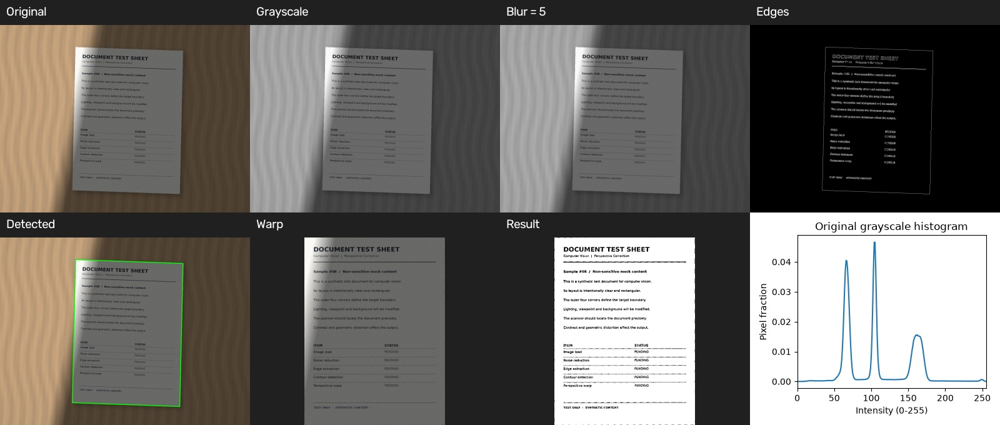

### shadow_04 — 통과

- **입력:** 그림자가 있는 명함.
- **결과·결론:** 그림자는 줄었지만 로고 정보 일부가 사라졌다.
- **No document 실패 블러:** 15, 17, 19, 21, 23, 25, 27, 29, 31.

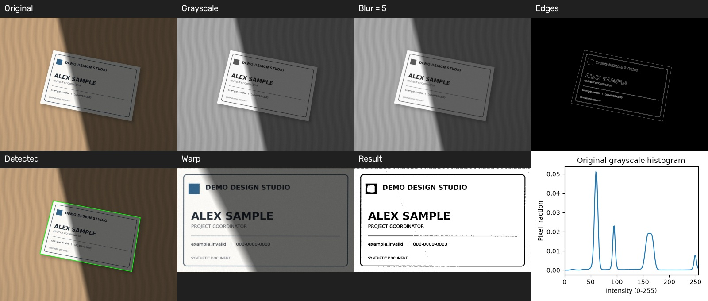

### shadow_05 — 통과

- **입력:** 문서 대부분이 그림자에 들어 있다.
- **결과·결론:** 외곽 검출과 정면화는 됐으며 어두운 부분의 작은 글씨는 확인이 필요하다.
- **No document 실패 블러:** 13, 15, 17, 19, 21, 23, 25, 27, 29, 31.

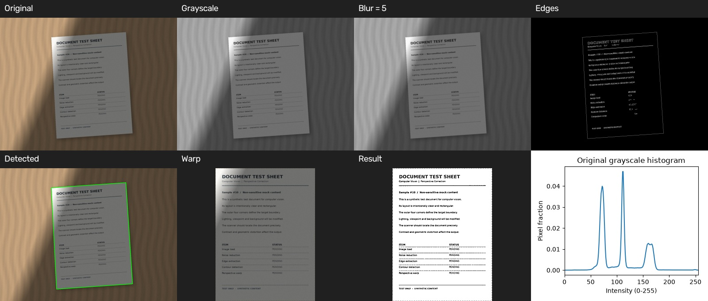

### tilted_01 — 통과

- **입력:** 위쪽이 좁게 보이는 문서.
- **결과·결론:** 문서가 펴졌지만 위쪽의 작은 글씨는 확대해도 세부 정보가 제한된다.
- **No document 실패 블러:** 23, 25, 27, 29, 31.

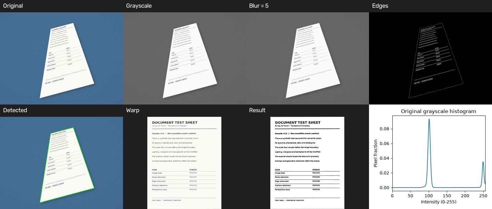

### tilted_02 — 통과

- **입력:** 원근 왜곡이 큰 문서.
- **결과·결론:** 정면화됐으나 흑백 글자 경계는 거칠다.
- **No document 실패 블러:** 23, 25, 27, 29, 31.

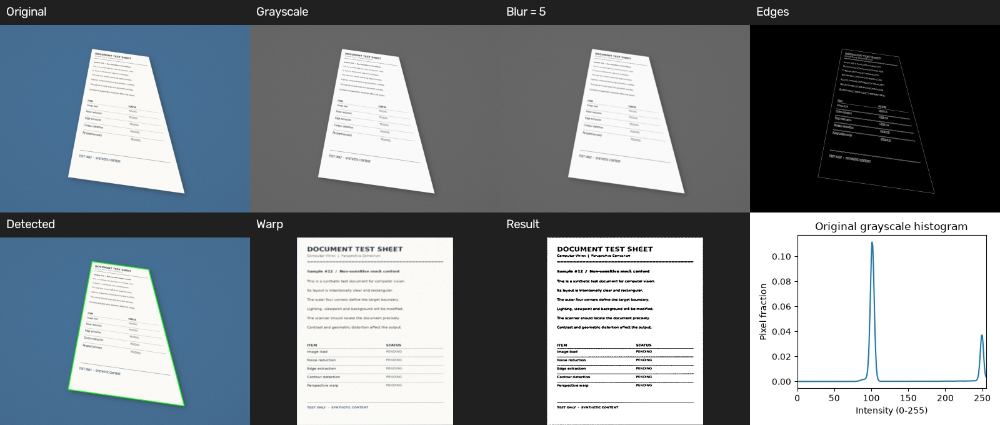

### tilted_03 — 통과

- **입력:** 회전하고 기울어진 영수증.
- **결과·결론:** 문서 외곽을 따라 검출되고 세로로 정렬됐다.
- **No document 실패 블러:** 23, 27, 29, 31.

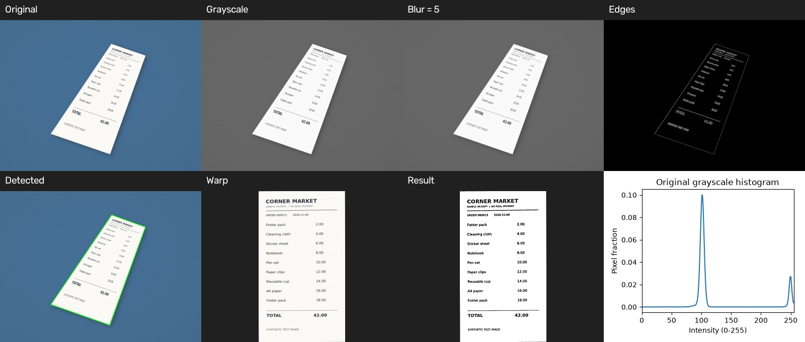

### tilted_04 — 통과

- **입력:** 위아래 폭 차이가 큰 문서.
- **결과·결론:** 문서 전체와 표 구조가 보정됐다.
- **No document 실패 블러:** 27, 29, 31.

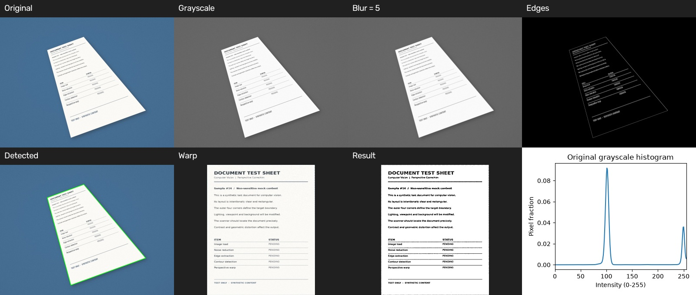

### tilted_05 — 보류

- **입력:** 원근 왜곡이 큰 명함.
- **결과·결론:** 외곽은 검출되지만 보정본이 세로로 길다. 실제 비율을 확인하기 전에는 정상 결과로 집계하지 않는다.
- **No document 실패 블러:** 23, 27, 29, 31.
- **채택:** 없음. 아래는 blur=5 결과이며 정상 판정 보류.

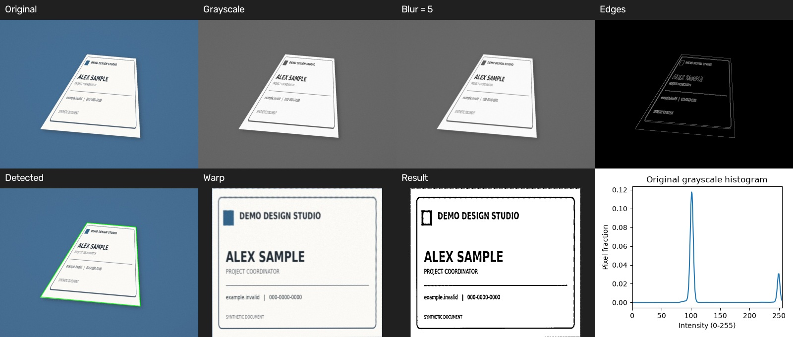

### complex_01 — 실패

- **입력:** 노트·키보드·펜이 있는 배경.
- **결과·결론:** 블러 16개 값 전부 No document. 이번 탐색 범위에서 검출 실패다. 다음 검토 대상은 경계 단절 연결이며 블러 조절만으로는 해결되지 않았다.
- **No document 실패 블러:** 1, 3, 5, 7, 9, 11, 13, 15, 17, 19, 21, 23, 25, 27, 29, 31.
- **재시도:** 16개 값 모두 미검출. 정상 채택값 없음.

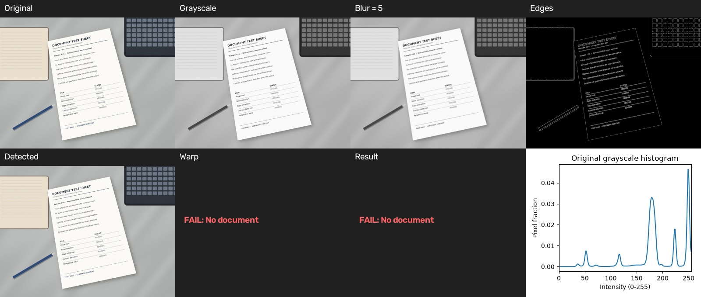

**블러 1~31 재시도 결과** — 각 칸의 `FAIL`은 실패다.

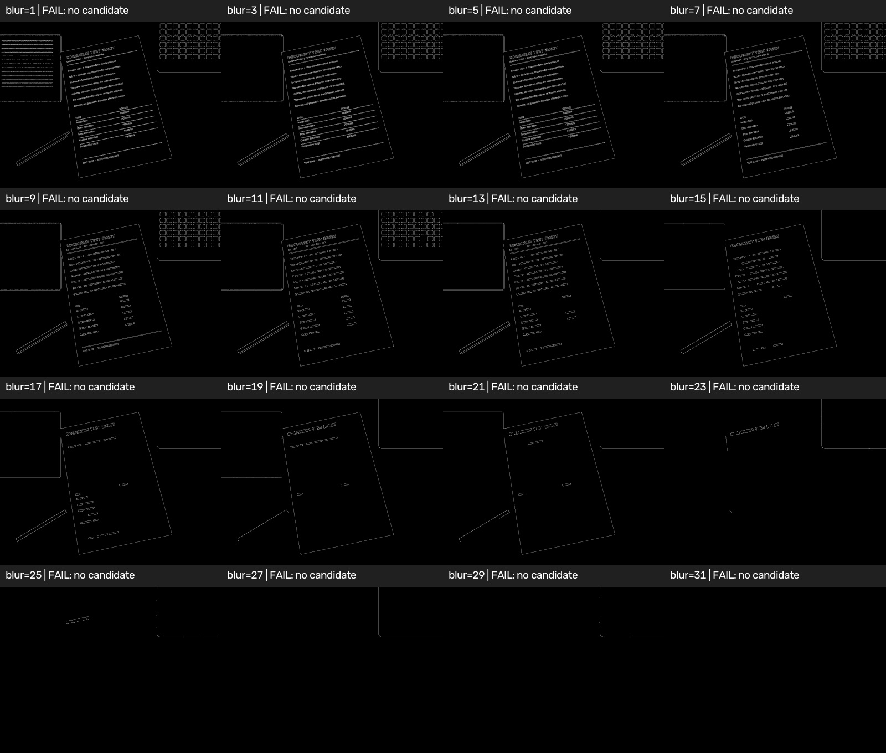

### complex_02 — 통과

- **입력:** 나무 무늬와 물체가 있는 배경의 영수증.
- **결과·결론:** 주변 사물 대신 영수증 외곽이 잡히고 정면화됐다.
- **No document 실패 블러:** 23, 25, 27, 29, 31.

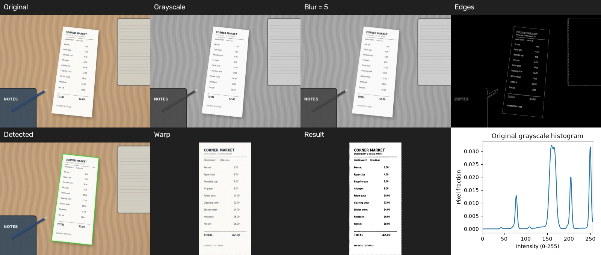

### complex_03 — 실패

- **입력:** 주변 물체와 가까운 문서.
- **결과·결론:** 블러 16개 값 전부 No document. 문서 외곽은 일부 보이지만 선택되는 사각형이 없어 검출 실패다. 다음에는 경계 연결 상태를 점검해야 한다.
- **No document 실패 블러:** 1, 3, 5, 7, 9, 11, 13, 15, 17, 19, 21, 23, 25, 27, 29, 31.
- **재시도:** 16개 값 모두 미검출. 정상 채택값 없음.

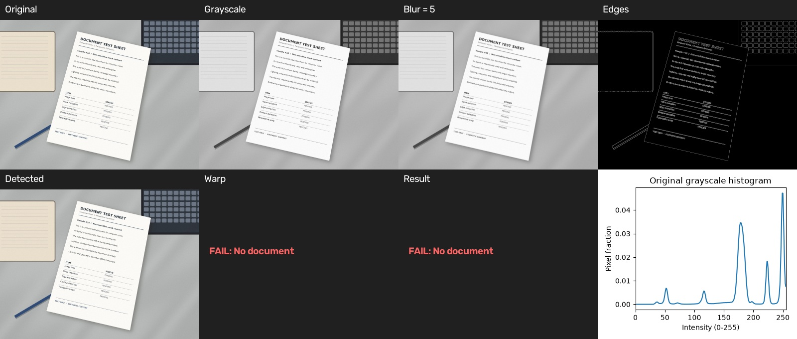

**블러 1~31 재시도 결과** — 각 칸의 `FAIL`은 실패다.

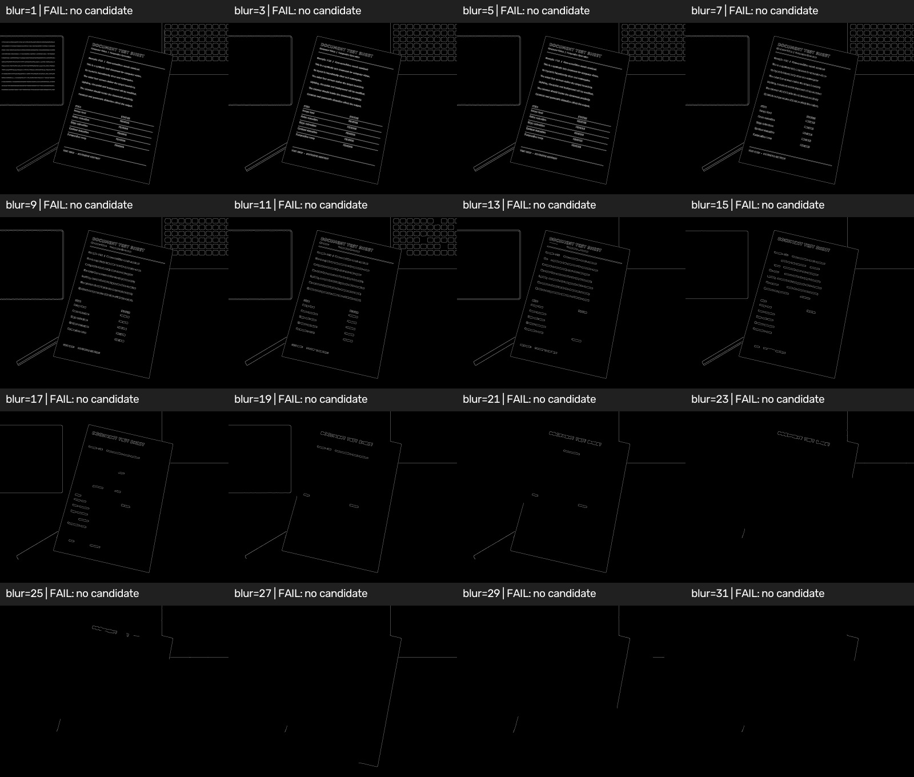

### complex_04 — 실패

- **입력:** 메모지가 오른쪽 위 모서리를 가린 문서.
- **결과·결론:** 블러 1·3에서는 후보가 생겼지만 오른쪽 경계가 문서 안을 지난다. 두 후보 모두 기각하고, 나머지 14개 값도 No document이므로 최종 실패다.
- **No document 실패 블러:** 5, 7, 9, 11, 13, 15, 17, 19, 21, 23, 25, 27, 29, 31.
- **재시도:** 1·3은 경계 오검출로 실패. 정상 채택값 없음.

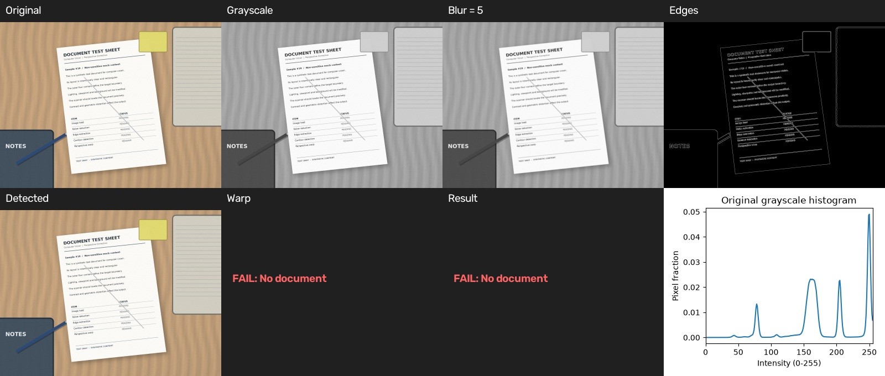

**블러 1~31 재시도 결과** — 각 칸의 `FAIL`은 실패다.

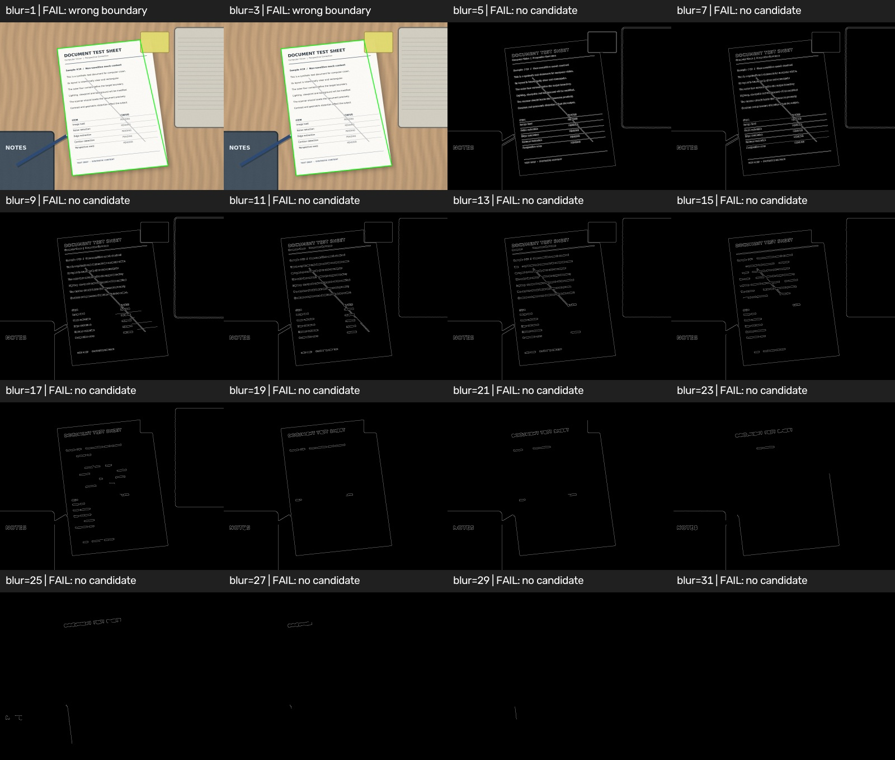

**기각한 후보:** blur=1·3 모두 오른쪽 외곽이 잘못 잡힌다. Warp·Result가 있어도 실패다.

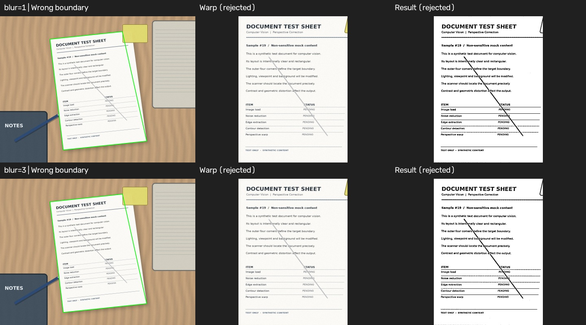

### complex_05 — 실패

- **입력:** 펜이 왼쪽 아래를 가린 명함.
- **결과·결론:** 블러 16개 값 전부 No document. 검출 실패다. 가림을 제거한 비교 입력이나 선분 기반 모서리 추정이 다음 검토 대상이다.
- **No document 실패 블러:** 1, 3, 5, 7, 9, 11, 13, 15, 17, 19, 21, 23, 25, 27, 29, 31.
- **재시도:** 16개 값 모두 미검출. 정상 채택값 없음.

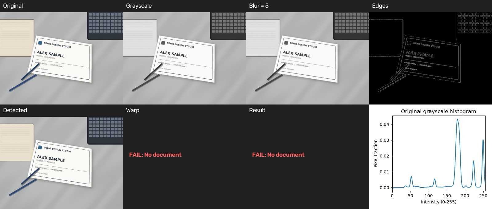

**블러 1~31 재시도 결과** — 각 칸의 `FAIL`은 실패다.

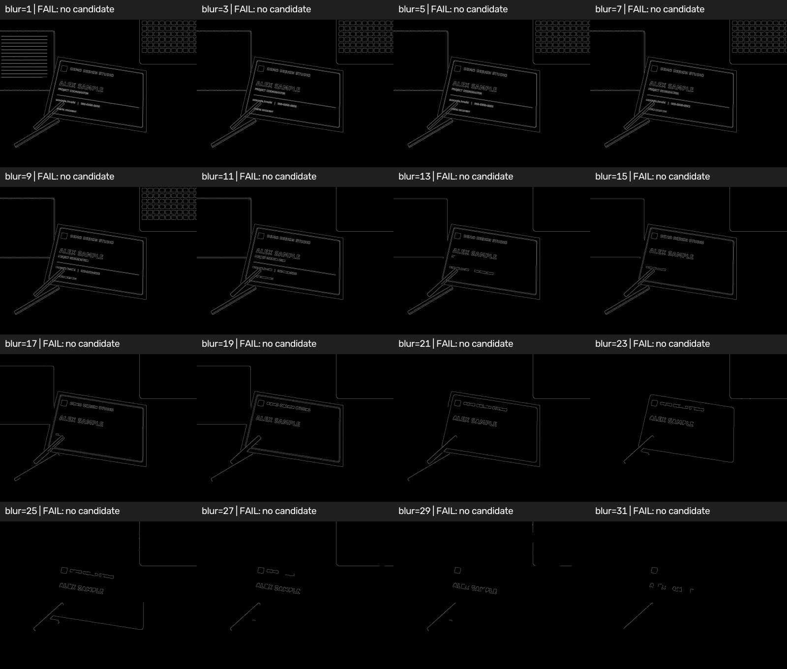

## 최종 결론

- 최종 통과는 15/20장(75%)이다. 블러 전 범위를 확인해도 complex_01·03·05는 미검출, complex_04는 경계 오검출로 실패했다. tilted_05는 비율 확인 보류다.
- **파라미터의 한계:** 블러는 잡음을 줄이지만 필요한 경계도 약하게 만들 수 있다. 실제로 값을 키우면 기존에 검출되던 이미지에서도 검출이 사라졌고, 실패 4장도 블러 조절만으로 해결되지 않았다.
- **규칙의 한계:** 현재 코드는 큰 볼록 사각형을 선택하므로 문서의 의미나 가려진 외곽을 판단하지 못한다. complex_04처럼 잘못된 경계도 조건을 만족할 수 있다. 경계 연결 같은 추가 규칙도 주변 물체를 함께 연결할 수 있어 모든 상황의 해결책은 아니다.
- **결과 품질:** 외곽 검출과 읽기 좋은 흑백 결과는 별개다. 이진화에서 가는 글자·로고가 손실될 수 있으며, 원근 보정만으로 실제 종횡비까지 보장하지는 않는다.
- **학습 기반 접근:** 배경·가림에 따른 한계를 줄이려면 다양한 조건의 문서 특징을 학습하는 검출·분할 모델을 후속 방법으로 검토할 수 있다. 다만 이번 과제에서는 구현·비교하지 않았으므로 성능 향상은 검증되지 않은 가설이다.

